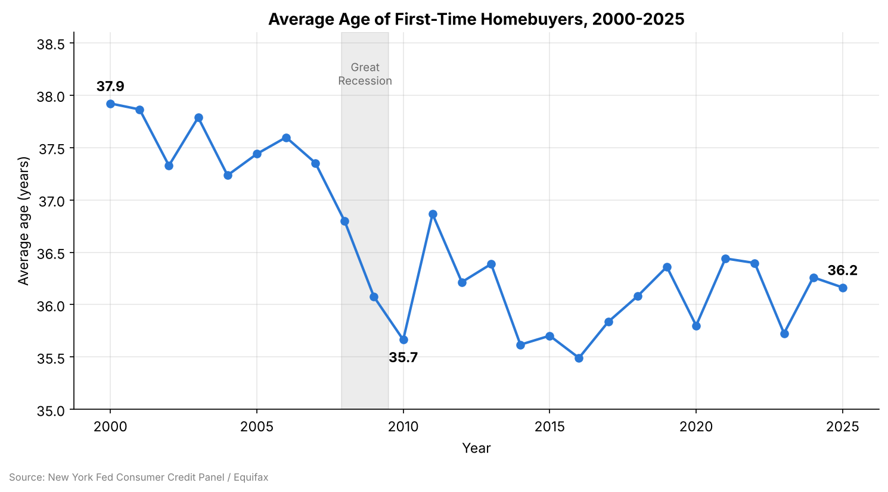
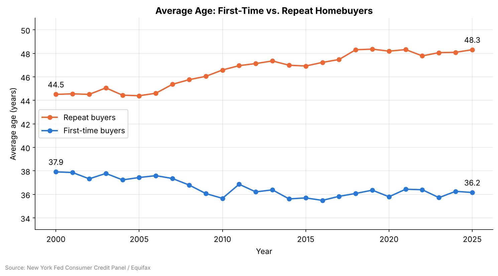
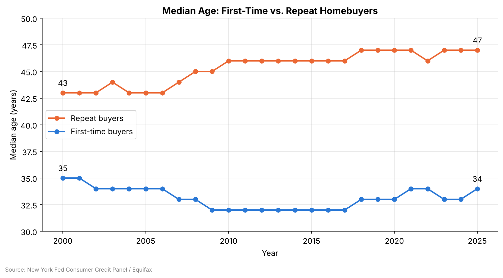
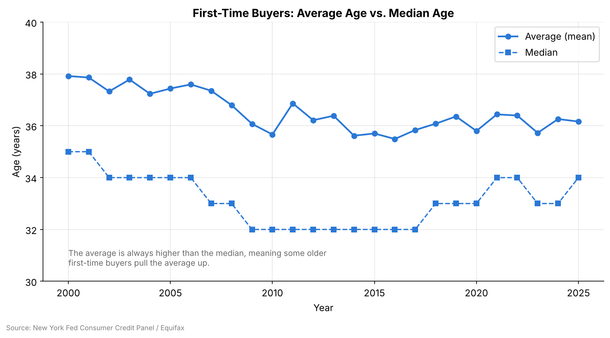
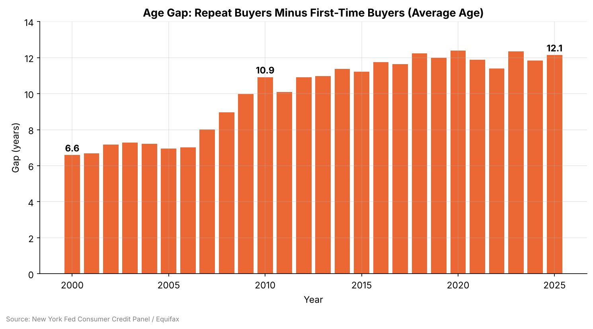
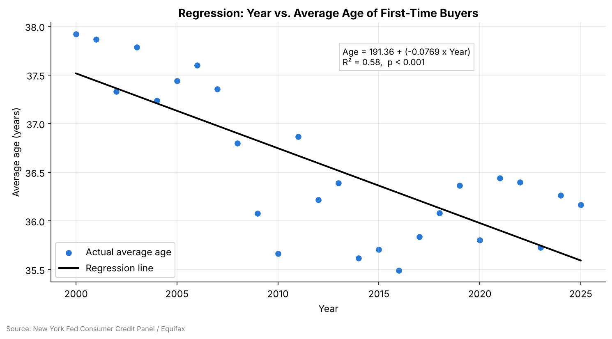

# 2 · Visualizations with Final Findings

## Chart 1: Average Age of First-Time Homebuyers

The average age dropped from 37.9 in 2000 to 35.7 in 2010, mostly around the Great Recession. Since then it has stayed in the mid-30s (36.2 in 2025).

## Chart 2: Average Age, First-Time vs. Repeat Buyers

Repeat buyers got older (44.5 → 48.3) while first-time buyers got slightly younger (37.9 → 36.2).

## Chart 3: Median Age, First-Time vs. Repeat Buyers

The medians show the same pattern. First-time buyers went 35 → 32 → 34, and repeat buyers went 43 → 47.

## Chart 4: First-Time Buyers, Average vs. Median

The average is always 2–5 years higher than the median, which means some older first-time buyers pull the average up.

## Chart 5: Age Gap Between Repeat and First-Time Buyers

The gap grew from 6.6 years in 2000 to 12.1 years in 2025, with the biggest jump between 2007 and 2010.

## Chart 6: Regression – Year vs. Average First-Time Buyer Age

The regression line slopes downward (R² = 0.58, p < 0.001). Most of the decline happened before 2010, though, so the line shouldn't be used to predict future ages.
