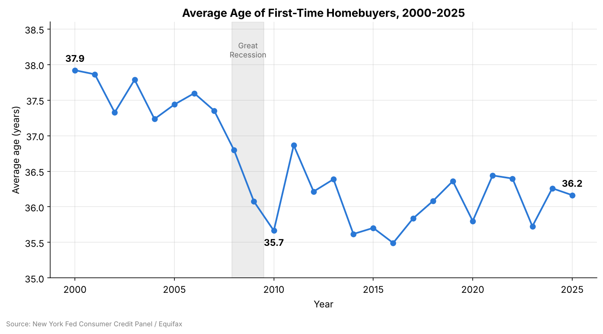
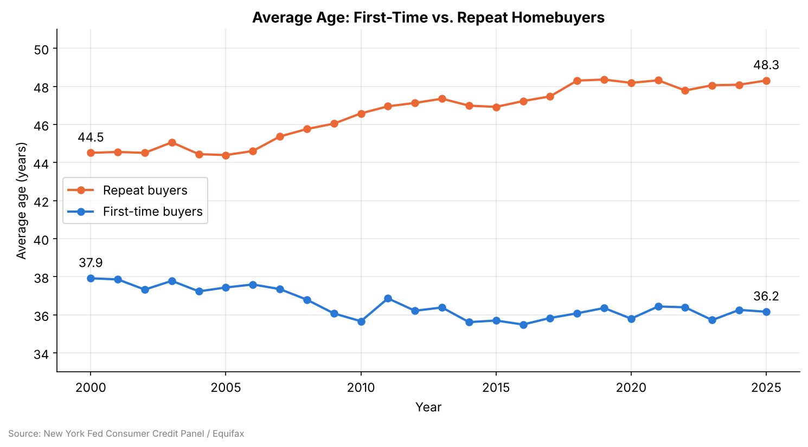
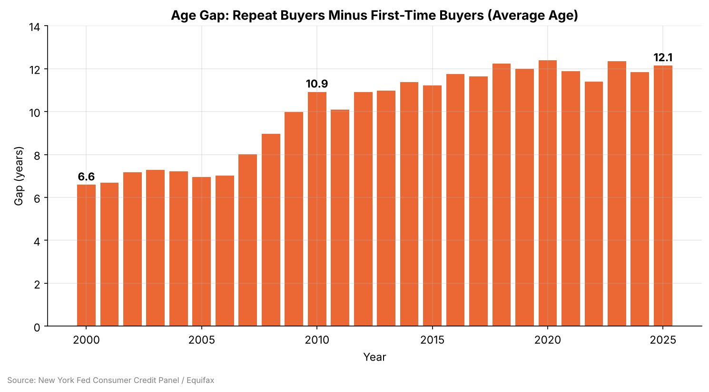
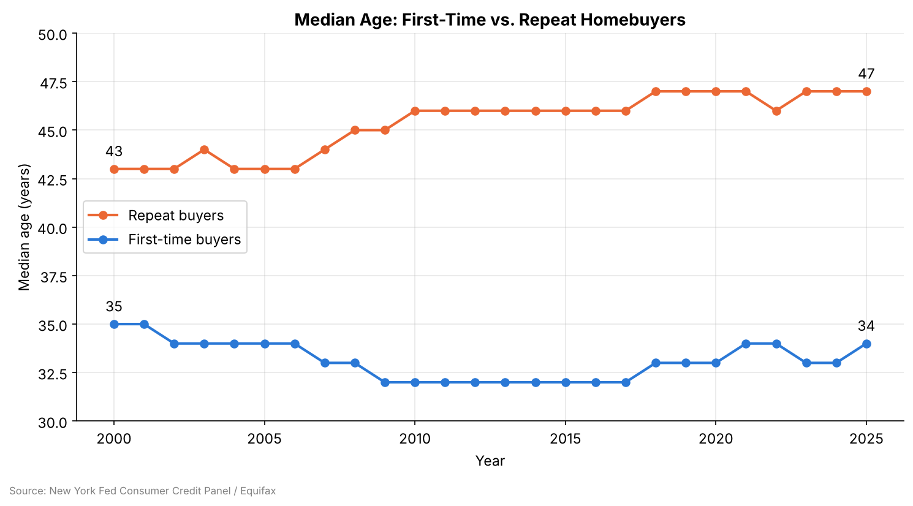
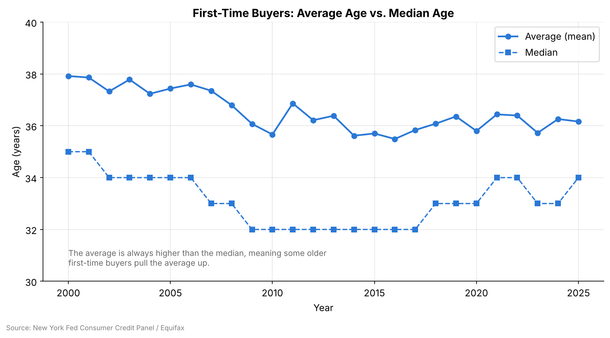
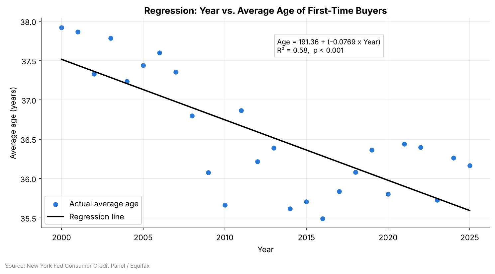

# The Changing Age of First-Time Homebuyers in the United States, 2000–2025

**BUS 446 Final Project – Business Case Report**

Noah Humphrey

---

## Executive Summary

A common belief is that Americans are waiting longer and longer to buy their first home. We tested this using 26 years of data on homebuyer ages. Our results show that **first-time buyers are actually a little younger now than in 2000**, while **repeat buyers have gotten older**.

| | 2000 | 2025 | Change |
|---|---:|---:|---:|
| Average age, first-time buyers | 37.9 | 36.2 | −1.8 years |
| Median age, first-time buyers | 35 | 34 | −1 year |
| Average age, repeat buyers | 44.5 | 48.3 | +3.8 years |
| Age gap (repeat minus first-time) | 6.6 | 12.1 | +5.6 years |

Main takeaways:

- The average first-time buyer age dropped between 2000 and 2010. Since 2010 it has stayed in the mid-30s.
- Repeat buyers got about four years older over the same period.
- Because the two groups moved in opposite directions, the age gap between them almost doubled.
- Our regression found a statistically significant relationship between year and first-time buyer age (R² = 0.58, p < 0.001).

---

## 1. Business Case

### The problem

Knowing the age of homebuyers helps many businesses make decisions:

- **Mortgage lenders** design first-time buyer loans and down-payment programs.
- **Real estate agents and homebuilders** decide who to market to and what types of homes to build.
- **Government housing agencies** set up programs to help first-time buyers.

If these organizations believe first-time buyers keep getting older when that isn't true, they may be targeting the wrong customers.

### Objectives

**Main question:** How have the ages of U.S. first-time homebuyers changed from 2000 to 2025, and how do they compare to repeat buyers?

We answered four supporting questions:

1. **Trend:** How have the average and median ages of first-time buyers changed over time?
2. **Comparison:** How big is the age gap between first-time and repeat buyers, and has it changed?
3. **Average vs. median:** Do the average and median show the same pattern?
4. **Regression:** Is the year related to the average age of first-time buyers?

---

## 2. Data

- **Dataset:** First-Time Homebuyer Age Statistics – Yearly Data (Excel file)
- **Source:** New York Fed Consumer Credit Panel / Equifax, published by Pinto, Tracy and Lee at the American Enterprise Institute (2025)
- **Time period:** 2000–2025 (26 years)
- **Variables:** year, plus the average age and median age of first-time and repeat buyers

**Data check:** we confirmed that all 26 years were included, with no missing values and no duplicate years.

**Limitations:**
- With only 26 yearly numbers, we can't look at individual buyers or different regions.
- The dataset only includes age, so it can't tell us *why* ages changed. We would need data on home prices, interest rates or income to answer that.
- The median ages are rounded to whole years.

---

## 3. Methodology

1. **Data preparation:** We loaded the Excel file into Python, organized it into one row per year, and checked for missing or duplicate data.
2. **Descriptive statistics:** We calculated the mean, minimum and maximum for each variable. We also calculated the age gap (repeat age minus first-time age) and averages for three time periods.
3. **Visualization:** We created six charts to show trends and comparisons.
4. **Regression:** We ran a simple linear regression with **year as X** and **average first-time buyer age as Y**.

---

## 4. Findings

### Question 1: How has the age of first-time buyers changed?

The average age of first-time buyers went from **37.9 in 2000** down to **35.7 in 2010**. Most of this drop happened around the Great Recession (2008–2009). After 2010, the average stayed between about 35.5 and 36.9. In 2025, it was **36.2**.

| Period | Avg first-time age | Avg repeat age | Avg gap |
|---|---:|---:|---:|
| 2000–2007 | 37.6 | 44.7 | 7.1 |
| 2008–2015 | 36.2 | 46.7 | 10.6 |
| 2016–2025 | 36.1 | 48.0 | 12.0 |

The period averages show the same thing: a drop from the first period to the second, then almost no change.

### Question 2: How do first-time and repeat buyers compare?

Repeat buyers went the opposite way. Their average age rose from **44.5 to 48.3**. As a result, the gap between the two groups grew from **6.6 years to 12.1 years**.

The gap grew the fastest between 2007 and 2010. It kept growing slowly after that and has been around 11–12 years since 2014.

### Question 3: Do the average and median show the same pattern?

Yes. The median age of first-time buyers dropped from 35 to 32 and has since gone back up to 34. The median age of repeat buyers rose from 43 to 47.

For first-time buyers, the **average is always higher than the median**, by about 2 to 5 years. This means a smaller group of older first-time buyers pulls the average up. The median is a better measure of the "typical" first-time buyer.

### Question 4: Is the year related to first-time buyer age?

| Result | Value |
|---|---|
| Equation | Age = 191.36 − 0.0769 × Year |
| Slope | −0.077 years per year (about −0.8 years per decade) |
| R² | 0.58 |
| p-value | < 0.001 |

**What this means:**
- The **negative slope** means first-time buyers have gotten slightly younger over time, by about one month per year on average.
- **R² = 0.58** means year explains about 58% of the changes in average first-time buyer age.
- **p < 0.05** means the relationship is statistically significant.

**One caution:** the chart shows that the points don't follow the straight line perfectly. Most of the decline happened before 2010, and the age has been fairly flat since. So we should **not** use this line to predict that first-time buyers will keep getting younger. Also, regression shows a relationship, not a cause. Year itself doesn't make people younger. Other factors that changed over time, like the economy and home prices, are likely behind it.

---

## 5. Insights and Recommendations

1. **Target first-time buyers in their early-to-mid 30s.** The typical (median) first-time buyer is 34. Lenders and real estate companies should aim their first-time buyer marketing and programs at people around 30–40, not people in their twenties.

2. **Treat repeat buyers as a separate group.** Repeat buyers are now about 48 on average and still getting older. Builders and lenders should offer products that fit this group, such as move-up homes, downsizing options and financing based on home equity.

3. **Don't use one "average buyer."** With a 12-year age gap, first-time and repeat buyers are at very different stages of life. Marketing teams should create separate customer profiles for each group.

4. **Don't assume the trend will continue.** First-time buyer age has been stable since 2010. Businesses should plan as if it will stay in the mid-30s unless there is a major economic change.

5. **Keep tracking the data and add more variables.** The median has risen a little since 2018 (from 32 to 34), so it's worth checking each year. Future studies should add home prices, interest rates and income to understand what drives these changes.

---

## 6. Conclusion

The belief that first-time buyers keep getting older is not supported by this data. First-time buyers became slightly younger between 2000 and 2010 and have stayed in their mid-30s since. Meanwhile, repeat buyers have gotten older, and the gap between the two groups has almost doubled. Our regression confirmed a significant relationship between year and first-time buyer age, but the trend has leveled off. Businesses that serve homebuyers should plan for two different groups: first-time buyers in their mid-30s and repeat buyers in their late 40s.

---

## References

- Pinto, E. J., Tracy, J. S., & Lee, D. (2025). *Median First-Time Homebuyer Age at 34 Years in 2025, Little Changed from 2024.* American Enterprise Institute.
- Federal Reserve Bank of New York. *New York Fed Consumer Credit Panel / Equifax.*
