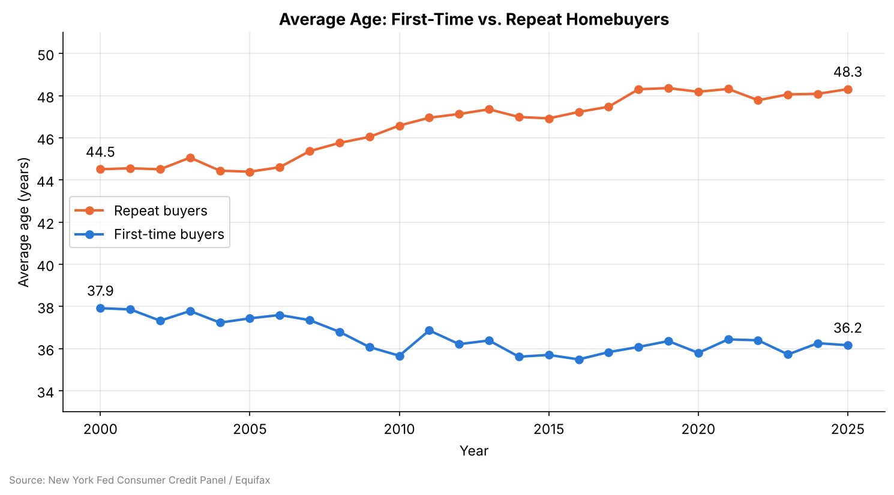

# The Changing Age of First-Time Homebuyers in the United States, 2000–2025

**BUS 446 Final Project** · Noah Humphrey

## Project Overview

Are Americans waiting longer to buy their first home? This project uses 26 years of homebuyer age data (2000–2025) to see how the ages of first-time buyers have changed and how they compare to repeat buyers.

**Main finding:** First-time buyers are slightly *younger* today than in 2000, while repeat buyers have gotten older. As a result, the age gap between the two groups has almost doubled.



## Repository Contents

| Folder | What's inside |
|---|---|
| 📁 [**1_Data_and_Method**](1_Data_and_Method/) | The dataset, data source information, the Python analysis code, and the results |
| 📁 [**2_Visualizations**](2_Visualizations/) | Six charts showing our final findings |
| 📁 [**3_Business_Case_Report**](3_Business_Case_Report/) | Our full business case report (readable on GitHub and as a PDF) |

## Key Findings

| | 2000 | 2025 | Change |
|---|---:|---:|---:|
| Average age, first-time buyers | 37.9 | 36.2 | −1.8 |
| Median age, first-time buyers | 35 | 34 | −1 |
| Average age, repeat buyers | 44.5 | 48.3 | +3.8 |
| Age gap (repeat − first-time) | 6.6 | 12.1 | +5.6 |

1. The average first-time buyer age dropped from 2000 to 2010 and has stayed in the mid-30s since.
2. Repeat buyers got about four years older.
3. The age gap between the two groups grew from 6.6 to 12.1 years.
4. The average age is always higher than the median, so a smaller group of older buyers pulls the average up.
5. Regression: year has a significant relationship with first-time buyer age (R² = 0.58, p < 0.001), but most of the change happened before 2010.

## Recommendations

- Target first-time buyer programs and marketing at people in their early-to-mid 30s.
- Treat repeat buyers (late 40s) as a separate customer group.
- Use separate customer profiles instead of one "average buyer."
- Don't assume first-time buyers will keep getting younger. The trend has leveled off.

## Data Source

New York Fed Consumer Credit Panel / Equifax, published in Pinto, Tracy & Lee (2025), *Median First-Time Homebuyer Age at 34 Years in 2025, Little Changed from 2024*, American Enterprise Institute. See [1_Data_and_Method](1_Data_and_Method/) for details and download instructions.

## How to Run the Analysis

```bash
git clone https://github.com/NoahHumphrey0517/BUS-446-Final-Project.git
cd BUS-446-Final-Project
pip install -r requirements.txt
python 1_Data_and_Method/src/analysis.py
```

## Tools Used

Python (pandas, matplotlib, scipy) and GitHub
